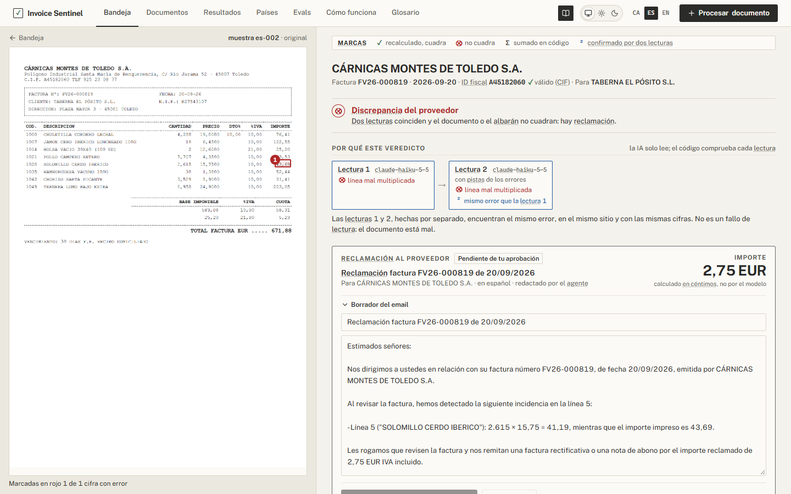
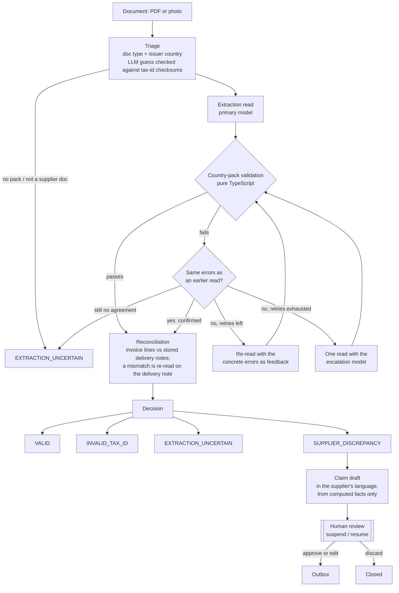

# Cross-border Invoice Sentinel

Reads supplier invoices, delivery notes and credit notes from restaurants in Spain, France, Italy, Portugal, Ireland, Denmark, Germany and the UK, checks that they add up under each country's tax rules, matches invoices against what was actually delivered, and drafts a claim to the supplier when something is wrong. A person approves every claim before it is sent.



The question the project is built around: **how do we add a new country in days, measure its accuracy from day one, and not break the countries that already work?**

The answer has three parts:

1. **Country packs.** Everything country-specific (tax rates, tax-id checksums, number and date formats, local field names, prompt hints) lives in one folder behind a single interface. The core never branches on a country code.
2. **A country-agnostic core.** The LLM only transcribes what is printed. Every number — bases, VAT, totals, differences, claim amounts — is recomputed in TypeScript, in integer cents.
3. **Evals per country with a regression gate.** Every country has a labelled dataset, absolute thresholds and a baseline. CI fails if any country drops.

## Design rules

- **The LLM transcribes, code calculates.** No amount the model writes is trusted until the validator has recomputed it.
- **Blame the extraction first.** A failed check triggers a re-read with the concrete errors fed back. It only counts as a supplier error when **two independent reads agree** on the same errors, at the same places, with the same printed values. A read that passes only after feedback must be confirmed by a blind read, so the model cannot "repair" what the supplier printed. Reads that never agree go to human review, never to a claim.
- **Nothing reaches a supplier without a human.** The workflow suspends before sending and resumes on approve, edit or discard.
- **The model is configuration.** `provider:model` strings (`anthropic:claude-haiku-5-5`), so models are compared on the same evals.
- **Evals measure the AI**, not just the code: accuracy per country and model, cost, latency, and claim quality (LLM judge).

## Workflow

One Mastra workflow per document ([processDocumentWorkflow.ts](packages/core/src/mastra/workflows/processDocumentWorkflow.ts)):



Final statuses:

| Status | Meaning |
| --- | --- |
| `VALID` | All checks pass (possibly after self-correction). |
| `SUPPLIER_DISCREPANCY` | Two reads agree the document itself does not add up, or billed goods were not delivered. A claim is drafted. |
| `INVALID_TAX_ID` | Two reads agree the printed issuer tax id fails its checksum. |
| `EXTRACTION_UNCERTAIN` | Reads never passed nor agreed, or disagree on the delivery note. Human review, never a claim. |

Every run is traced in Langfuse: one span per step and per extraction attempt, tags `country:`, `docType:`, `status:`, and scores (`tax_math_passed`, `final_status`, `extraction_attempts`, `cost_usd`, and `human_approved` / `human_edited` after review). The extraction prompt is served from Langfuse prompt management, with the version-controlled copy as fallback.

## Repository layout

```
packages/core/            country-agnostic core + country packs (Mastra, Zod, Vitest)
  src/countries/<cc>/     one folder per country pack
  src/countries/registry.ts
  src/validation/         validator engine (tax math, rates, brackets, totals)
  src/decision/           "extraction error vs supplier error"
  src/reconciliation/     invoice ↔ delivery-note matching
  src/claims/             claim facts, draft, outbox
  src/mastra/             agents and the workflow
evals/                    datasets, runner, metrics, gate, LLM judge, reports
  datasets/<cc>/          synthetic documents + exact ground truth
  thresholds.json         per-country floors/ceilings and the regression rule
  baseline.json           last accepted numbers per country
apps/web/                 Next.js app: inbox, document inspection, claim approval, /evals
```

## Running it

Needs Node ≥ 20.9.

```bash
npm install
cp .env.example .env            # ANTHROPIC_API_KEY; Langfuse keys optional
npm test                        # unit tests (core + gate)
npm run evals                   # every country through the real workflow, then the gate
npm run evals:smoke             # 11-document subset used by CI
npm run dev                     # web app on http://localhost:3000
```

Without Langfuse keys everything runs the same, just without traces. LLM calls are cached in `evals/reports/cache/` (not in git); `--no-cache` forces fresh calls.

Useful eval flags: `--country=es,fr`, `--model=anthropic:claude-sonnet-5-5`, `--escalation=…`, `--retries=2`, `--no-cascade`, `--limit=5`, `--ids=es-001,fr-003`, `--update-baseline`.

### Read-only demo

`NEXT_PUBLIC_SENTINEL_DEMO=1` (at build and run time) turns the web app into a read-only demo: the inbox shows the documents in [apps/web/demo/records](apps/web/demo/records), processed beforehand with Haiku 5.5, and the routes that would call a model or resume a claim answer 403. It needs no API key, so it can be hosted without spending tokens.

```bash
NEXT_PUBLIC_SENTINEL_DEMO=1 npm run build -w @sentinel/web
NEXT_PUBLIC_SENTINEL_DEMO=1 npm run start -w @sentinel/web
```

## Adding a country

Example: the Netherlands (`NL`).

1. **Pack.** Copy `packages/core/src/countries/fr/` to `nl/` and fill in the `CountryPack` ([types.ts](packages/core/src/countries/types.ts)):
   - `rules.ts`: allowed VAT rates, local field names (`Factuur`, `Pakbon`, `BTW-id`…), rate hints, pack version.
   - `validators.ts`: tax-id checksum (BTW-id, mod 11 or mod 97).
   - `prompt-context.ts`: what a Dutch invoice looks like, for the extractor.
   - `index.ts`: amount and date parsing (shared helpers in `countries/shared/format.ts` cover most of Europe).
2. **Register it.** One line in [registry.ts](packages/core/src/countries/registry.ts): add `nlPack` to the `for (const pack of [...])` list. Registration validates the pack's shape and fails fast.
3. **Unit tests.** Tax-id checksums and formats, next to [new-packs.test.ts](packages/core/test/new-packs.test.ts) and [fr-it.packs.test.ts](packages/core/test/fr-it.packs.test.ts).
4. **Dataset.** Add an `NL_CONFIG` next to the others ([locales.ts](evals/generator/locales.ts), [locales-more.ts](evals/generator/locales-more.ts)) (suppliers, labels, the typical stale-ERP bug, its own `seedOffset`) and its entry in `COUNTRY_CONFIGS`, then run `npm run gen:dataset -- --country=nl` (needs `npx playwright install chromium`). Real, anonymised documents go next to them as `real-<n>.{jpg,pdf}` plus `real-<n>.json` (same shape as the synthetic entries, `"source": "real"`); regenerating keeps them and lists them in `manifest.json`. The eval runner picks up every dataset folder with a `manifest.json`.
5. **Measure.** `npm run evals -- --country=nl`. The new country starts from the `default` thresholds in [thresholds.json](evals/thresholds.json). Once the numbers are accepted, `npm run evals -- --update-baseline` (full run) records its baseline, and from then on any drop of more than 5 points fails CI.

Nothing in the workflow, validator engine, decision logic, claim drafting, eval runner or web app changes. FR and IT were added exactly this way, then PT, IE, DK, DE and GB. Those five needed three small shared changes, none of them country branches:
- amount parsing strips `kr.`/`DKK`, dates accept `3rd October` and `3. Oktober`, and keyword hints fold `æ`/`ø`/`ß`;
- the dataset templates print the pack's currency (`£`, `kr.`) and decimal separator instead of a fixed `€` and comma;
- the triage prompt lists the new document names, so it got a new version (`triage-v2`).

Cases that make the new packs worth having: Ireland and the UK zero-rate most food (0 % is a legal rate with its own bracket), Denmark has a single 25 % rate and another currency (DKK), the UK uses GBP and a decimal point, and Germany accepts either a USt-IdNr. (checksum) or a Steuernummer (format only).

## Reading the eval report

Each run writes `evals/reports/runs/<commit>-<model>-<prompt>.{md,json}` and `evals/reports/latest.md`. The `/evals` page in the web app shows the same runs side by side.

| Metric | What it tells you |
| --- | --- |
| Documents 100 % correct | Every header field and every line matches the ground truth exactly. The strictest number. |
| Final status correct | The pipeline reached the right decision (`VALID`, `SUPPLIER_DISCREPANCY`…). This is what the restaurant feels. |
| Discrepancy precision / recall | Of the claims raised, how many were real; of the real supplier errors, how many were caught. |
| Unfair claims | Claims raised on clean documents. Must be 0: a wrong claim damages a supplier relationship. |
| Reconciliation status correct | Invoice vs delivery note matched correctly. |
| Claim amount correct / judge (1–5) / invented data | The claim asks for the right amount, reads well (LLM judge), and states nothing that is not in the documents. |
| Mean extraction attempts / escalated | How often self-correction and the stronger model were needed. |
| Cost / doc, latency p50 / p95 | Per document, all LLM calls included. |

The **gate** section at the bottom lists every check per country: absolute thresholds, then regression against `baseline.json`. One ✖ fails the run (exit 1), which fails CI.

To compare two runs field by field: `npm run evals:compare -- <baselineRun> <candidateRun>` → `evals/reports/compare/`.

Caveat when reading the numbers: 30 documents per country means one document is 3.3 points. Differences of a point or two between runs are noise.

## Current results

282 synthetic documents (ES 59, IT 33, PT 40, 30 for each other country), primary model `anthropic:claude-haiku-5-5`, escalation `anthropic:claude-sonnet-5-5`, prompt `extract-v3`. Run `24ccf06-anthropic_claude-haiku-5-5-extract-v3` (also the baseline). Full report: [evals/reports/latest.md](evals/reports/latest.md).

| Metric | ES | FR | IT | PT | IE | DK | DE | GB |
| --- | --- | --- | --- | --- | --- | --- | --- | --- |
| Documents 100 % correct | 93.2 % | 90.0 % | 97.0 % | 92.5 % | 93.3 % | 96.7 % | 83.3 % | 96.7 % |
| Final status correct | 100 % | 100 % | 100 % | 100 % | 100 % | 100 % | 100 % | 100 % |
| Discrepancy precision / recall | 100 / 100 % | 100 / 100 % | 100 / 100 % | 100 / 100 % | 100 / 100 % | 100 / 100 % | 100 / 100 % | 100 / 100 % |
| Unfair claims | 0 % | 0 % | 0 % | 0 % | 0 % | 0 % | 0 % | 0 % |
| Claim judge (1–5) | 4.71 | 4.71 | 4.75 | 4.67 | 4.86 | 4.71 | 4.71 | 5.00 |
| Cost / document | $0.0021 | $0.0019 | $0.0020 | $0.0020 | $0.0019 | $0.0019 | $0.0019 | $0.0018 |

"Documents 100 % correct" is the strictest metric: every field must match the ground truth. The misses are fields no verdict rests on (line descriptions, discount percentages, document numbers, the recipient's name or tax id, and the Portuguese ATCUD code on phone photos), which is why every final status is still right.

### Model comparison

Same 105 documents, same prompts, only the primary model changes ([Sonnet run](evals/reports/runs/8b0fd8e-anthropic_claude-sonnet-5-5-extract-v2.md)).

| Metric (all countries) | Haiku 5.5 | Sonnet 5.5 |
| --- | --- | --- |
| Documents 100 % correct | 93.3 % | 94.3 % |
| Final status correct | 100 % | 98.1 % |
| Discrepancy recall | 100 % | 96.3 % |
| Unfair claims | 0 % | 1.3 % (1 document) |
| Claim amount correct | 100 % | 95.7 % |
| Cost / document | $0.0018 | $0.0277 (15×) |
| Latency p50 | 7.5 s | 8.7 s |

The stronger model transcribes slightly better but decides worse, and the gate rejects it. Two of its failures matter more than the averages:

- **It "repaired" a supplier's tax id.** On `es-018` the printed CIF fails its checksum on purpose. Sonnet's first read transcribed it exactly; after the retry feedback said the control character did not match, the second read changed the last digit so it would pass → `VALID` instead of `INVALID_TAX_ID`.
- **Two agreeing reads can agree on the same misread.** On `it-010` (a low-quality photo) both reads misread the same three digits of the Partita IVA → `INVALID_TAX_ID` on a clean document. Two reads from the same model on the same image are not fully independent.

Haiku stays the primary model; Sonnet is kept as the escalation model only.

The first failure became a rule: **a read that passes only after feedback must be reproduced by a blind read** (no feedback, no previous attempt). On `es-018` the blind read transcribes the invalid CIF again, agrees with read #1, and the result is `INVALID_TAX_ID`. If the blind read neither passes nor agrees, the document goes to human review. The second failure is still open: a second read by a different model, or of a re-rendered crop, would make the two reads more independent.

## Known limitations

- The dataset is synthetic and probably easier than real documents.
- Small n: 30 documents per country, so one document moves a metric by 3 points and the 5-point regression rule is stricter than sampling noise. A misread delivery-note reference (`es-041`: `A18-2603387` for `ALB-2603387`) once failed the ES gate; invoices now fall back to the only stored note of the same supplier within a couple of edits (`findNear`), and the match is stated in the decision reason.
- The escalation to the stronger model has never been triggered on this dataset, so its effect is unmeasured.
- The remaining errors are in fields no validator checks (document numbers on receipt photos, descriptions).
- "Exact" field matching allows ±0.01 per number, so a one-cent misread counts as correct there; the claim-amount metric still catches it.
- The outbox does not send e-mail; approved claims are recorded, not delivered.
