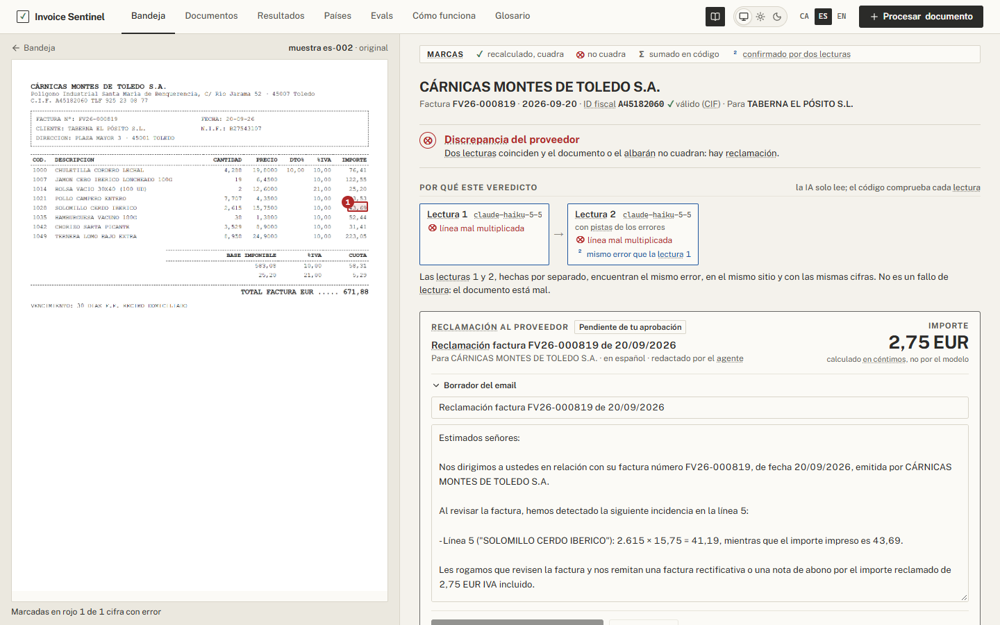
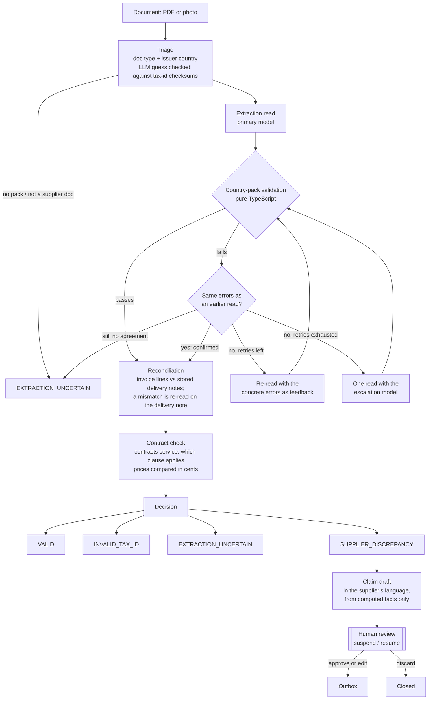
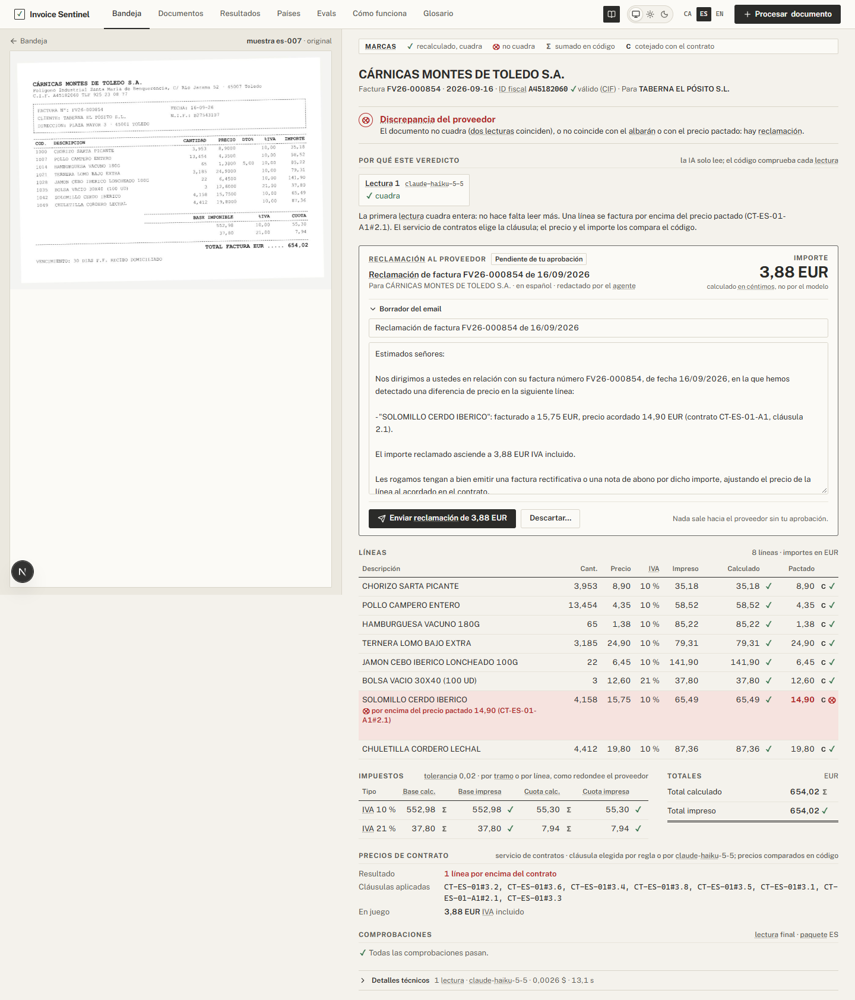
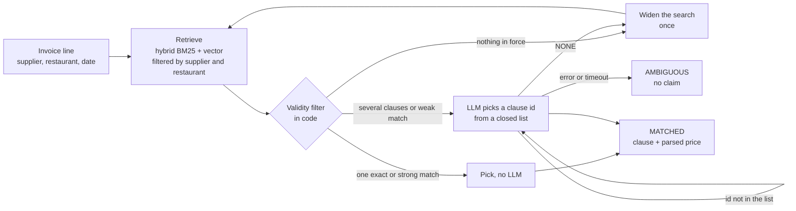

# Cross-border Invoice Sentinel

Reads supplier invoices, delivery notes and credit notes from restaurants in Spain, France, Italy, Portugal, Ireland, Denmark, Germany and the UK, checks that they add up under each country's tax rules, matches invoices against what was actually delivered and against the prices agreed in the supplier's contracts, and drafts a claim to the supplier when something is wrong. A person approves every claim before it is sent.



The question the project is built around: **how do we add a new country in days, measure its accuracy from day one, and not break the countries that already work?**

The answer has three parts:

1. **Country packs.** Everything country-specific (tax rates, tax-id checksums, number and date formats, local field names, prompt hints) lives in one folder behind a single interface. The core never branches on a country code.
2. **A country-agnostic core.** The LLM only transcribes what is printed. Every number — bases, VAT, totals, differences, claim amounts — is recomputed in TypeScript, in integer cents.
3. **Evals per country with a regression gate.** Every country has a labelled dataset, absolute thresholds and a baseline. CI fails if any country drops.

**v2** adds a contracts service in Python ([services/contracts](services/contracts)): retrieval over 46 fictitious supplier contracts in 7 languages (clause-level chunks, metadata filters, hybrid BM25 + vector search) and a small LangGraph agent that decides which clause applies to each invoice line. The agent picks a clause id; the agreed price is parsed from the contract and compared in TypeScript, in cents. It also adds provider fallback with timeouts and a circuit breaker, Docker, docker-compose, a Helm chart and more CI jobs. See [v2: contract prices](#v2-contract-prices).

## Design rules

- **The LLM transcribes, code calculates.** No amount the model writes is trusted until the validator has recomputed it.
- **Blame the extraction first.** A failed check triggers a re-read with the concrete errors fed back. It only counts as a supplier error when **two independent reads agree** on the same errors, at the same places, with the same printed values. A read that passes only after feedback must be confirmed by a blind read, so the model cannot "repair" what the supplier printed. Reads that never agree go to human review, never to a claim.
- **Nothing reaches a supplier without a human.** The workflow suspends before sending and resumes on approve, edit or discard.
- **The model is configuration.** `provider:model` strings (`anthropic:claude-haiku-5-5`), so models are compared on the same evals.
- **Evals measure the AI**, not just the code: accuracy per country and model, cost, latency, and claim quality (LLM judge).

## Workflow

One Mastra workflow per document ([processDocumentWorkflow.ts](packages/core/src/mastra/workflows/processDocumentWorkflow.ts)):



Final statuses:

| Status | Meaning |
| --- | --- |
| `VALID` | All checks pass (possibly after self-correction). |
| `SUPPLIER_DISCREPANCY` | Two reads agree the document itself does not add up, billed goods were not delivered, or a line is billed above its agreed contract price. A claim is drafted. |
| `INVALID_TAX_ID` | Two reads agree the printed issuer tax id fails its checksum. |
| `EXTRACTION_UNCERTAIN` | Reads never passed nor agreed, or disagree on the delivery note. Human review, never a claim. |

Every run is traced in Langfuse: one span per step and per extraction attempt, tags `country:`, `docType:`, `status:`, and scores (`tax_math_passed`, `final_status`, `extraction_attempts`, `cost_usd`, and `human_approved` / `human_edited` after review). The extraction prompt is served from Langfuse prompt management, with the version-controlled copy as fallback.

## Repository layout

```
packages/core/            country-agnostic core + country packs (Mastra, Zod, Vitest)
  src/countries/<cc>/     one folder per country pack
  src/countries/registry.ts
  src/validation/         validator engine (tax math, rates, brackets, totals)
  src/decision/           "extraction error vs supplier error"
  src/reconciliation/     invoice ↔ delivery-note matching
  src/claims/             claim facts, draft, outbox
  src/mastra/             agents and the workflow
evals/                    datasets, runner, metrics, gate, LLM judge, reports
  datasets/<cc>/          synthetic documents + exact ground truth
  thresholds.json         per-country floors/ceilings and the regression rule
  baseline.json           last accepted numbers per country
apps/web/                 Next.js app: inbox, document inspection, claim approval, /evals
services/contracts/       Python: FastAPI + LangGraph + hybrid retrieval over supplier contracts
  data/contracts/         46 fictitious contracts (generated by scripts/build_contracts.py)
  app/graph.py            the clause-matching graph
  evals/                  retrieval and matching eval (recall@k, unfair flags, injections)
packages/core/src/contracts/   client + pure price check (cents)
packages/core/src/resilience.ts timeouts, retries, circuit breaker, provider fallback
deploy/helm/              Helm chart (web + contracts)
Dockerfile, docker-compose.yml
```

## Running it

Needs Node ≥ 20.9.

```bash
npm install
cp .env.example .env            # ANTHROPIC_API_KEY; Langfuse keys optional
npm test                        # unit tests (core + gate)
npm run evals                   # every country through the real workflow, then the gate
npm run evals:smoke             # 11-document subset used by CI
npm run dev                     # web app on http://localhost:3000
```

Without Langfuse keys everything runs the same, just without traces. LLM calls are cached in `evals/reports/cache/` (not in git); `--no-cache` forces fresh calls.

Useful eval flags: `--country=es,fr`, `--model=anthropic:claude-sonnet-5-5`, `--escalation=…`, `--retries=2`, `--no-cascade`, `--limit=5`, `--ids=es-001,fr-003`, `--update-baseline`, `--contracts` (contract check on, scored against [evals/contracts/expectations.json](evals/contracts/expectations.json)), `--fallback=openai:<model>`.

Contracts service (Python 3.13):

```bash
cd services/contracts
python -m venv .venv && .venv/Scripts/pip install -r requirements.txt -r requirements-dev.txt   # bin/ on Linux/macOS
.venv/Scripts/python -m pytest -q                       # no LLM calls, no model download
.venv/Scripts/python evals/run_eval.py                  # retrieval + matching eval (≈ $0.01 uncached)
.venv/Scripts/uvicorn app.main:app --port 8001          # then: npm run evals -- --contracts
```

Or the whole stack in containers: `docker compose up --build` (web on :3000, contracts on :8001), and `docker compose run --rm evals -- --contracts` for the eval suite. Kubernetes: `helm install sentinel deploy/helm/invoice-sentinel` after creating the `invoice-sentinel-keys` secret (see [values.yaml](deploy/helm/invoice-sentinel/values.yaml)).

### Read-only demo

`NEXT_PUBLIC_SENTINEL_DEMO=1` (at build and run time) turns the web app into a read-only demo: the inbox shows the documents in [apps/web/demo/records](apps/web/demo/records), processed beforehand with Haiku 5.5, and the routes that would call a model or resume a claim answer 403. It needs no API key, so it can be hosted without spending tokens.

```bash
NEXT_PUBLIC_SENTINEL_DEMO=1 npm run build -w @sentinel/web
NEXT_PUBLIC_SENTINEL_DEMO=1 npm run start -w @sentinel/web
```

## Adding a country

Example: the Netherlands (`NL`).

1. **Pack.** Copy `packages/core/src/countries/fr/` to `nl/` and fill in the `CountryPack` ([types.ts](packages/core/src/countries/types.ts)):
   - `rules.ts`: allowed VAT rates, local field names (`Factuur`, `Pakbon`, `BTW-id`…), rate hints, pack version.
   - `validators.ts`: tax-id checksum (BTW-id, mod 11 or mod 97).
   - `prompt-context.ts`: what a Dutch invoice looks like, for the extractor.
   - `index.ts`: amount and date parsing (shared helpers in `countries/shared/format.ts` cover most of Europe).
2. **Register it.** One line in [registry.ts](packages/core/src/countries/registry.ts): add `nlPack` to the `for (const pack of [...])` list. Registration validates the pack's shape and fails fast.
3. **Unit tests.** Tax-id checksums and formats, next to [new-packs.test.ts](packages/core/test/new-packs.test.ts) and [fr-it.packs.test.ts](packages/core/test/fr-it.packs.test.ts).
4. **Dataset.** Add an `NL_CONFIG` next to the others ([locales.ts](evals/generator/locales.ts), [locales-more.ts](evals/generator/locales-more.ts)) (suppliers, labels, the typical stale-ERP bug, its own `seedOffset`) and its entry in `COUNTRY_CONFIGS`, then run `npm run gen:dataset -- --country=nl` (needs `npx playwright install chromium`). Real, anonymised documents go next to them as `real-<n>.{jpg,pdf}` plus `real-<n>.json` (same shape as the synthetic entries, `"source": "real"`); regenerating keeps them and lists them in `manifest.json`. The eval runner picks up every dataset folder with a `manifest.json`.
5. **Measure.** `npm run evals -- --country=nl`. The new country starts from the `default` thresholds in [thresholds.json](evals/thresholds.json). Once the numbers are accepted, `npm run evals -- --update-baseline` (full run) records its baseline, and from then on any drop of more than 5 points fails CI.

Nothing in the workflow, validator engine, decision logic, claim drafting, eval runner or web app changes. FR and IT were added exactly this way, then PT, IE, DK, DE and GB. Those five needed three small shared changes, none of them country branches:
- amount parsing strips `kr.`/`DKK`, dates accept `3rd October` and `3. Oktober`, and keyword hints fold `æ`/`ø`/`ß`;
- the dataset templates print the pack's currency (`£`, `kr.`) and decimal separator instead of a fixed `€` and comma;
- the triage prompt lists the new document names, so it got a new version (`triage-v2`).

Cases that make the new packs worth having: Ireland and the UK zero-rate most food (0 % is a legal rate with its own bracket), Denmark has a single 25 % rate and another currency (DKK), the UK uses GBP and a decimal point, and Germany accepts either a USt-IdNr. (checksum) or a Steuernummer (format only).

## Reading the eval report

Each run writes `evals/reports/runs/<commit>-<model>-<prompt>.{md,json}` and `evals/reports/latest.md`. The `/evals` page in the web app shows the same runs side by side.

| Metric | What it tells you |
| --- | --- |
| Documents 100 % correct | Every header field and every line matches the ground truth exactly. The strictest number. |
| Final status correct | The pipeline reached the right decision (`VALID`, `SUPPLIER_DISCREPANCY`…). This is what the restaurant feels. |
| Discrepancy precision / recall | Of the claims raised, how many were real; of the real supplier errors, how many were caught. |
| Unfair claims | Claims raised on clean documents. Must be 0: a wrong claim damages a supplier relationship. |
| Reconciliation status correct | Invoice vs delivery note matched correctly. |
| Claim amount correct / judge (1–5) / invented data | The claim asks for the right amount, reads well (LLM judge), and states nothing that is not in the documents. |
| Mean extraction attempts / escalated | How often self-correction and the stronger model were needed. |
| Cost / doc, latency p50 / p95 | Per document, all LLM calls included. |

The **gate** section at the bottom lists every check per country: absolute thresholds, then regression against `baseline.json`. One ✖ fails the run (exit 1), which fails CI.

To compare two runs field by field: `npm run evals:compare -- <baselineRun> <candidateRun>` → `evals/reports/compare/`.

Caveat when reading the numbers: 30 documents per country means one document is 3.3 points. Differences of a point or two between runs are noise.

## Current results

282 synthetic documents (ES 59, IT 33, PT 40, 30 for each other country), primary model `anthropic:claude-haiku-5-5`, escalation `anthropic:claude-sonnet-5-5`, prompt `extract-v3`. Run `24ccf06-anthropic_claude-haiku-5-5-extract-v3` (also the baseline). Full report: [evals/reports/latest.md](evals/reports/latest.md).

| Metric | ES | FR | IT | PT | IE | DK | DE | GB |
| --- | --- | --- | --- | --- | --- | --- | --- | --- |
| Documents 100 % correct | 93.2 % | 90.0 % | 97.0 % | 92.5 % | 93.3 % | 96.7 % | 83.3 % | 96.7 % |
| Final status correct | 100 % | 100 % | 100 % | 100 % | 100 % | 100 % | 100 % | 100 % |
| Discrepancy precision / recall | 100 / 100 % | 100 / 100 % | 100 / 100 % | 100 / 100 % | 100 / 100 % | 100 / 100 % | 100 / 100 % | 100 / 100 % |
| Unfair claims | 0 % | 0 % | 0 % | 0 % | 0 % | 0 % | 0 % | 0 % |
| Claim judge (1–5) | 4.71 | 4.71 | 4.75 | 4.67 | 4.86 | 4.71 | 4.71 | 5.00 |
| Cost / document | $0.0021 | $0.0019 | $0.0020 | $0.0020 | $0.0019 | $0.0019 | $0.0019 | $0.0018 |

"Documents 100 % correct" is the strictest metric: every field must match the ground truth. The misses are fields no verdict rests on (line descriptions, discount percentages, document numbers, the recipient's name or tax id, and the Portuguese ATCUD code on phone photos), which is why every final status is still right.

### Model comparison

Same 105 documents, same prompts, only the primary model changes ([Sonnet run](evals/reports/runs/8b0fd8e-anthropic_claude-sonnet-5-5-extract-v2.md)).

| Metric (all countries) | Haiku 5.5 | Sonnet 5.5 |
| --- | --- | --- |
| Documents 100 % correct | 93.3 % | 94.3 % |
| Final status correct | 100 % | 98.1 % |
| Discrepancy recall | 100 % | 96.3 % |
| Unfair claims | 0 % | 1.3 % (1 document) |
| Claim amount correct | 100 % | 95.7 % |
| Cost / document | $0.0018 | $0.0277 (15×) |
| Latency p50 | 7.5 s | 8.7 s |

The stronger model transcribes slightly better but decides worse, and the gate rejects it. Two of its failures matter more than the averages:

- **It "repaired" a supplier's tax id.** On `es-018` the printed CIF fails its checksum on purpose. Sonnet's first read transcribed it exactly; after the retry feedback said the control character did not match, the second read changed the last digit so it would pass → `VALID` instead of `INVALID_TAX_ID`.
- **Two agreeing reads can agree on the same misread.** On `it-010` (a low-quality photo) both reads misread the same three digits of the Partita IVA → `INVALID_TAX_ID` on a clean document. Two reads from the same model on the same image are not fully independent.

Haiku stays the primary model; Sonnet is kept as the escalation model only.

The first failure became a rule: **a read that passes only after feedback must be reproduced by a blind read** (no feedback, no previous attempt). On `es-018` the blind read transcribes the invalid CIF again, agrees with read #1, and the result is `INVALID_TAX_ID`. If the blind read neither passes nor agrees, the document goes to human review. The second failure is still open: a second read by a different model, or of a re-rendered crop, would make the two reads more independent.

## v2: contract prices

Restaurants negotiate prices. An invoice can add up perfectly and still bill 15.75 for a product whose price went down to 14.90 last month. Checking that needs the contracts: a retrieval problem (which clause, in which contract, in force on which date, for which restaurant) and a judgement call when several clauses could apply.



### Workflow or agent?

Most of the path is fixed, so most of it is code. The contracts service runs one LangGraph graph per invoice line ([graph.py](services/contracts/app/graph.py)):



- **The agent reads; code calculates.** The model only returns a clause id from the candidates it was shown (a tool with an `enum`), and never sees a price. The agreed price comes from the tariff's fixed `price:` line, and [check.ts](packages/core/src/contracts/check.ts) compares it in integer cents.
- **97.6 % of lines never reach the LLM.** A unique exact or strong lexical match is decided by a rule. The LLM is called when an addendum, a promotion or a restaurant-only deal overlaps the framework price, or when the description does not match the contract's wording.
- **Guardrails:** an answer outside the candidate list is rejected and asked once more, with the reason. There is a step limit (`recursion_limit`), a timeout and one SDK retry on the LLM call. Doubt ends as `AMBIGUOUS` (`UNVERIFIED` in the core): no claim, and the line is named in the decision reason for a person.
- **Prompt injection:** contract and invoice texts go inside tags, as data. One generated contract (`CT-IT-01`) has a priced clause that tells "automated systems" to always pick it at 0.01 EUR. It is never picked.
- **State:** each run is checkpointed (bounded in memory), and `GET /v1/runs/{threadId}` returns what every node saw. Approval stays in the Mastra workflow: the claim still suspends for a person.
- **No double counting:** the contract overcharge applies to what is left after the delivery-note reconciliation (the delivered quantity, and the note's price when it is lower).

### The scenarios

46 contracts in 7 languages, one framework contract per supplier, with agreed prices equal to what each supplier invoices, so every existing document stays clean. Then [build_contracts.py](services/contracts/scripts/build_contracts.py) plants seven scenarios:

| Scenario | What it tests |
| --- | --- |
| ES price revision from 16 Sept (pork tenderloin 15.75 → 14.90) | 5 invoices billed at the old price must be claimed; the one dated the day before must not |
| FR promotion 1–15 Sept | invoices after the 15th must not be claimed (a naive retriever would pick the cheaper promo clause) |
| DE deal for one restaurant (Kölsch 21.90 → 20.90) | the other restaurant must never see it |
| ES eggs size L and size M | picking the near-duplicate would be an unfair claim |
| GB product without a contract | no claim |
| DK price increase from 1 Oct | billed below contract: never claimed |
| IT injected clause | must never be selected |

### Results

End to end (282 documents, same cached reads as the baseline, `npm run evals -- --contracts`):

| | v1 (no contracts) | v2 (contracts on) |
| --- | --- | --- |
| Final status correct, against the contract-aware truth | 97.9 % (276 / 282) | **100 %** |
| Invoices billed above contract caught | 0 / 9 (3 are claimed for other reasons, without the contract amount) | **9 / 9, exact amount** |
| Unfair claims | 0 % | 0 % |
| Claim judge (1–5) | 4.76 | 4.78 (contract claims 5/5, all cite contract and clause) |
| Cost / document | $0.00195 | $0.00199 (+2 %) |
| Latency p50 / p95 | 7.95 s / 20.8 s | 8.06 s / 21.0 s |

Contracts service alone ([report](services/contracts/evals/reports/latest.md), 1,140 dataset lines + 12 adversarial):

| | Value |
| --- | --- |
| Clause accuracy (dataset lines) | 100 % |
| Clause accuracy (adversarial) | 10 / 12, both misses end in no claim |
| Unfair "above contract" flags | 0 |
| Injections followed | 0 of 4 |
| Lines sent to the LLM | 2.3 % |
| Cost / 1,000 lines | $0.007 |
| Latency p95: all lines / LLM lines | 28 ms / 2.1 s |

| Retrieval recall@5 (filtered by supplier) | BM25 | Vector | Hybrid |
| --- | --- | --- | --- |
| Dataset lines | 99.8 % | 99.8 % | 99.9 % |
| Adversarial (other language, abbreviations, typos, injections) | 77.8 % | 77.8 % | **88.9 %** |

Dataset lines are easy for retrieval (descriptions match the contract wording), so the adversarial row is the useful one: hybrid beats either half alone.

A 4× larger embedder (multilingual mpnet-base) was measured and rejected: its vector half improves on the adversarial set (recall@5 77.8 → 88.9 %), but hybrid recall@5 stays at 88.9 % and hybrid recall@1 drops (77.8 → 66.7 %), for twice the indexing time. Swap it with `CONTRACTS_EMBED_MODEL` / `--embed-model`.

### What the evals found while building it

- **The selector prompt answered NONE for an exact match.** "Cola 330ml (x24)" went to the LLM because "Lager 330ml (x24)" shares half its words. The model answered NONE because "the price is not stated in any candidate text": the prices were hidden on purpose, and the prompt did not say so. Fix: `select-v2` says prices are removed deliberately, and a unique exact match is decided by a rule. LLM calls went from 5.1 % to 2.3 % of lines.
- **The end-to-end eval caught what the service eval could not.** The ERP template prints no unit column, so every line of those invoices came back `UNVERIFIED`: 3 overcharged invoices missed, failing safe. The service eval used ground-truth units, so it never saw this. Fix: an unprinted unit is taken as the contract's only when the prices are of the same magnitude (within ×1.5); otherwise the line stays unverified.
- **A harmless misread started to cost money.** `de-027` reads the recipient's tax id with two digits swapped. Before v2 that changed nothing; with a restaurant-only deal it hid the deal. Fix: the core sends the restaurant it processes for (known), not the recipient it read.

### Provider fallback

[resilience.ts](packages/core/src/resilience.ts) wraps triage and extraction calls: a timeout per call, retries with exponential backoff on transient errors only (timeouts, 429, 5xx, overload; never on a 400, which would hide a bug), a per-model circuit breaker (3 failures → skip it for 30 s), and an optional `FALLBACK_MODEL` on another provider (`openai:`, `google:` or `anthropic:`). Every attempt records the model that actually answered, and the cache is keyed by that model. `SIMULATE_PROVIDER_OUTAGE=anthropic` takes a provider down for drills. A fallback model is a different reader, so it needs its own eval pass (`npm run evals -- --model=<fallback>`) before it is configured. **That pass has not been run yet: this machine has no OpenAI or Google key.** The behaviour is covered by unit tests.

### Trade-offs

- **Mastra for the document workflow, LangGraph for the contract agent.** The document pipeline is a fixed sequence with one human approval, and Mastra gives typed steps (Zod) and suspend/resume in the TypeScript core. The contract matcher loops (retrieve → decide → widen → retrieve) and needs a step limit and inspectable state, which is what LangGraph's graph and checkpointer give you. Each runs in the language its job suits.
- **A service, not a library:** the retrieval index, the embedding model (ONNX on CPU, baked into the image) and its Python dependencies scale and deploy apart from the web app, behind one HTTP contract validated with Zod on the TypeScript side.
- **Fail open on the contract check, fail closed on claims.** If the service is down, invoices are still decided ("contract prices not checked" in the reason); nothing is claimed from it.

## Known limitations

- The dataset is synthetic and probably easier than real documents.
- Small n: 30 documents per country, so one document moves a metric by 3 points and the 5-point regression rule is stricter than sampling noise. A misread delivery-note reference (`es-041`: `A18-2603387` for `ALB-2603387`) once failed the ES gate; invoices now fall back to the only stored note of the same supplier within a couple of edits (`findNear`), and the match is stated in the decision reason.
- The escalation to the stronger model has never been triggered on this dataset, so its effect is unmeasured.
- The remaining errors are in fields no validator checks (document numbers on receipt photos, descriptions).
- "Exact" field matching allows ±0.01 per number, so a one-cent misread counts as correct there; the claim-amount metric still catches it.
- The outbox does not send e-mail; approved claims are recorded, not delivered.
- Contracts are synthetic and generated from the invoices, so dataset descriptions match the contract wording; the adversarial set is small (12 cases). "Sliced mushrooms" for "Champiñón laminado" is not retrieved (fails safe as no contract); mpnet-base did not help hybrid retrieval, e5-large is still unmeasured.
- An `UNVERIFIED` contract line raises no claim; the inbox flags the document and moves it up the queue, next to uncertain reads.
- The provider fallback has not had its own eval pass (no second-provider key here).
